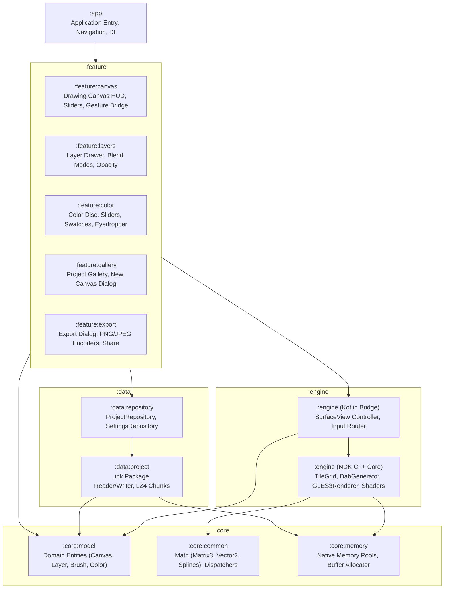

# Inkwell - System Architecture Specification (Phase 3)

## 1. High-Level Architectural Principles
- **Decoupled Rendering & UI**: Jetpack Compose handles all UI chrome (sliders, popovers, layer stack, color picker), while a dedicated NDK/OpenGL ES 3.2 rendering pipeline owns the drawing surface via a hardware `SurfaceView`.
- **Zero-GC Hot Path**: Touch processing, spline interpolation, dab stamping, and tile memory operations run in native C++ (or pre-allocated direct memory buffers), completely immune to JVM garbage collection pauses.
- **Sparse Tiled Canvas**: Memory scales with painted content, not canvas dimensions. A $4096 \times 4096$ canvas with a single brush stroke consumes $<1\text{ MB}$ of tile memory, not $64\text{ MB}$.
- **Atomic Persistence**: Non-destructive, crash-safe project packaging using atomic file swapping and LZ4-compressed tile chunks.

---

## 2. Technology Evaluations & Selections

### 2.1 Language & UI Framework
- **Selection**: **Kotlin + Jetpack Compose** (UI Chrome) + **C++20 via NDK** (Graphics & Brush Core).
- **Tradeoff Analysis**:
  - *Jetpack Compose*: Offers rapid, declarative, state-driven UI composition for complex floating controls, layer drag-and-drop lists, and gallery grids. Runs on the Android UI thread.
  - *SurfaceView Decoupling*: The drawing surface is isolated in an Android `SurfaceView`. Touch events are routed directly to the native engine, bypassing Compose's layout and draw passes.

### 2.2 Rendering API: Comparison & Recommendation
| Criterion | Android Canvas / Skia | Vulkan (1.1+) | OpenGL ES 3.2 (Recommended) |
| :--- | :--- | :--- | :--- |
| **Driver Stability** | High (System-level) | Variable across Android 10–12 vendors (Adreno/Mali driver bugs) | **Rock-Solid** across 100% of target Android 10+ devices |
| **Input-to-Photon Latency**| 32–48ms (HWUI vsync buffering) | <16ms (manual swapchain management) | **<16ms** (direct EGL presentation to Surface) |
| **Custom Shaders / Blends**| Limited without AGSL (API 33+) | Complete explicit control | **Complete**: GLSL ES 3.00 shaders for 12 blend modes |
| **Memory Control** | Inflexible (managed by Skia) | Manual explicit allocation | **Fine-grained**: Direct FBOs, PBOs, Texture sub-updates |
| **Implementation Risk** | High risk of frame drops | High risk of OEM driver crashes & extreme boilerplate | **Optimal**: Highly stable, battle-tested on mobile GPUs |

- **Recommendation**: **OpenGL ES 3.2** (with GLES 3.0 fallback). GLES 3.2 provides instanced quad drawing (`glDrawElementsInstanced`), Framebuffer Objects (FBOs) for ping-pong layer composition, Pixel Buffer Objects (PBOs) for asynchronous texture uploads, and float/half-float texture support, without the severe driver fragmentation risks of Vulkan on Android 10/11 tablets.

### 2.3 Native Code (NDK / C++) Boundary
- **Selection**: **Hybrid C++ Core with Lean JNI Interface**.
- **Engine Core (C++20)**:
  - `TileGrid`: Sparse 2D spatial hash map of $256 \times 256$ pixel buffers.
  - `DabGenerator`: Catmull-Rom spline evaluator, streamline moving-average filter, and arc-length spacing stepper.
  - `GLES3Renderer`: Shaders, FBO ping-pong composition, instanced dab stamping.
  - `SmudgeEngine`: High-speed SIMD/NEON color sampling and pigment transfer.
  - `DeltaEngine`: Fast LZ4 tile diff compression.
- **JNI Protocol**:
  - High-level, low-frequency event batching. JNI is called once per input event packet with raw float arrays (`float[] points`), never per-pixel or per-dab. JNI call overhead is $<0.01\text{ ms}$ per frame.

---

## 3. Canvas & Memory Model

### 3.1 Sparse Tiled Grid
- **Tile Dimensions**: $256 \times 256$ pixels, 4 bytes/pixel (RGBA8888) = $256\text{ KB}$ per tile uncompressed.
- **Grid Layout**: A $4096 \times 4096$ canvas consists of $16 \times 16 = 256$ tiles per layer.
- **Sparse Allocation**: Unpainted tiles occupy 0 bytes. Tiles are allocated on-demand when a dab's bounding box intersects the tile coordinate $(col, row)$.
- **Dirty Region Tracking**: During a stroke, an axis-aligned bounding box and dirty tile coordinate set are maintained. Only dirty tiles are re-uploaded to GPU textures and serialized into undo deltas.

### 3.2 Memory Budgeting & Eviction
- **Budget Determination**: Informs capacity using `ActivityManager.getLargeMemoryClass()` (typically 512MB–1024MB on target tablets).
- **Hard Limit**: Engine limits in-memory uncompressed tile footprint to 60% of available large heap.
- **Memory Pool**: A pre-allocated pool of direct $256\text{ KB}$ memory chunks prevents heap fragmentation and runtime allocations.
- **RAM Compression**: Tiles belonging to inactive layers or distant non-viewport areas are compressed in-RAM using LZ4 ($\sim 8\times$ compression ratio, reducing $256\text{ KB} \to \sim 32\text{ KB}$), decompressed on-demand in $<0.2\text{ ms}$.

---

## 4. Input Processing & Smoothing Pipeline

```
MotionEvent (240Hz / 360Hz Digitizer)
   │
   ▼
[Palm Rejection Filter] ──(Finger touch rejected if Stylus active)──┐
   │ (Valid Stylus Event)                                           │
   ▼                                                                ▼
[Historical Batch Extractor] (getHistoricalX/Y/Pressure/Tilt)     [Drop]
   │
   ▼
[Pressure & Tilt Calibration]
   │  p_calibrated = ((p_raw - p_min) / (1 - p_min))^gamma
   │  tilt_factor  = cos(tilt_altitude)
   ▼
[Streamline EMA Damping Filter] (Damps micro-tremor)
   │
   ▼
[Centripetal Catmull-Rom Spline] (C^1 continuous curve evaluation)
   │
   ▼
[Arc-Length Dab Spacing Stepper] (Emits dabs at delta_s = spacing * size)
   │
   ▼
[Native Dab Batch -> GLES3 Instanced Draw / Tile Rasterizer]
```

- **Stylus Arbitration**:
  - `TOOL_TYPE_STYLUS` sets `stylusActiveLock = true` (with 300ms trailing hysteresis).
  - All `TOOL_TYPE_FINGER` events during active lock are dropped to prevent accidental palm marks.
  - Multi-touch gestures (2-finger pinch/rotate/pan) are recognized only when both pointers are `TOOL_TYPE_FINGER` and stylus is not in proximity.

---

## 5. Undo / Redo Architecture: Tile-Diff Journaling

- **Pattern**: Hybrid **Command Pattern + Tile-Delta Snapshots**.
- **Mechanism**:
  1. `StrokeCommand` records:
     - Target Layer ID.
     - Affected tile coordinates: $[(col_0, row_0), (col_1, row_1), \dots]$.
     - Pre-stroke tile pixel payloads (compressed with LZ4).
     - Post-stroke tile pixel payloads (compressed with LZ4 on stroke completion).
  2. Structural commands (`LayerAddCommand`, `LayerDeleteCommand`, `LayerReorderCommand`) record layer metadata state changes.
- **Performance Characteristics**:
  - Memory consumption: A typical stroke modifying 10 tiles costs $\approx 10 \times 30\text{ KB} = 300\text{ KB}$ in the undo stack.
  - 50 undo steps consume $\approx 15\text{ MB} - 30\text{ MB}$, well within the memory budget.
  - Restore speed: Decompressing 10 tiles and blitting into native memory takes $<2\text{ ms}$ ($<50\text{ ms}$ response requirement easily met).

---

## 6. Storage & File Format Specification (`.ink`)

### 6.1 Container Structure
The `.ink` project is packaged as an atomic ZIP container:
```
project.ink (ZIP package)
├── manifest.json         # Container format version (1.0), App version, UUID, timestamp
├── canvas.json           # Width, height, DPI, colorProfile, backgroundColor
├── thumbnail.png         # 512x512 downsampled flattened composite preview
├── layers/
│   ├── layers.json       # Array of layer descriptors (id, name, opacity, blendMode, visible, locked)
│   ├── layer_{id}/
│   │   ├── index.bin     # Packed tile index: [int16 col, int16 row, uint32 offset, uint32 size]
│   │   └── tiles.lz4     # Sequential LZ4 compressed tile payloads
└── palettes/
    └── swatches.json     # Custom color palettes associated with project
```

### 6.2 Atomic Crash Recovery
- Saves are executed via a temporary file: `${projectName}.ink.tmp`.
- Data is flushed and synced to disk via `fsync()`.
- On completion, `File.renameTo()` performs an atomic swap over `${projectName}.ink`.
- If an unexpected termination occurs mid-write, the original `.ink` file remains 100% intact.

---

## 7. Multi-Module Project Architecture


