# Inkwell - Capability Dependency Tree (Phase 2)

This document decomposes every **MUST (v1.0)** feature backward from its completed user-facing state down to underlying architectural primitives by repeatedly asking:
> *"What has to exist immediately before this capability works?"*

---

## 1. Backward Decomposition Plain List

### Feature 1: Export Image (PNG / JPEG)
- **Export PNG/JPEG**
  - $\leftarrow$ SAF File Saver & Android Share Sheet Intent
  - $\leftarrow$ Image Encoder (PNG lossless encoder, JPEG compressor)
  - $\leftarrow$ Flattened Full-Canvas RGBA8888 Pixel Buffer
  - $\leftarrow$ Layer Stack Compositor (full offscreen multi-layer composite pass)
  - $\leftarrow$ Layer System & Blend Mode Pipeline (ordered evaluation of all visible layers)
  - $\leftarrow$ Per-Layer Tile Grid (sparse tile collection)
  - $\leftarrow$ Tile Memory Storage & Allocator
  - $\leftarrow$ **Primitives**: Raw Byte Buffers (`ByteBuffer`/native pointer), File I/O (`OutputStream`/SAF).

### Feature 2: Project Save, Load & Autosave (`.ink` format)
- **Project Persistence & Autosave**
  - $\leftarrow$ Atomic File Writer (`.ink.tmp` $\to$ atomic rename) & Crash Recovery Validator
  - $\leftarrow$ Project Package Container (archive format / directory container)
  - $\leftarrow$ Project Metadata Serializer (Canvas dimensions, DPI, Layer hierarchy, Blend modes, Active palettes, Brush metadata)
  - $\leftarrow$ Thumbnail Generator (downscaled composite render)
  - $\leftarrow$ Tile Chunk Compressor & Serializer (LZ4 / Zstd compression on non-empty tiles)
  - $\leftarrow$ Dirty Tile Tracker (tracking modified tiles since last save)
  - $\leftarrow$ Tile Memory Storage
  - $\leftarrow$ **Primitives**: File I/O, Compression algorithm, Memory buffers.

### Feature 3: Undo / Redo System
- **Undo / Redo (50+ Steps, <50ms)**
  - $\leftarrow$ Undo/Redo Gesture Detector (2-finger tap undo, 3-finger tap redo) & UI Buttons
  - $\leftarrow$ History Manager (bounded action stack, undo/redo deques, RAM/disk size cap)
  - $\leftarrow$ Reversible Action Command Abstractions:
    - *Stroke Action*: records tile delta records before & after stroke
    - *Layer Action*: records layer structural mutations (add, delete, reorder, opacity, blend mode)
  - $\leftarrow$ Tile Snapshot & Delta Diffing Engine (captures pre-stroke state of dirty tiles, computes delta)
  - $\leftarrow$ Dirty Tile Bounding Box Tracker
  - $\leftarrow$ Tile Memory Storage & Allocator
  - $\leftarrow$ **Primitives**: Deque/Stack data structures, Fast byte memory copy (`memcpy`/`Buffer.put`).

### Feature 4: Color Picker, Palettes & Eyedropper
- **Color Selection System**
  - $\leftarrow$ Eyedropper Tool & Magnifying Loupe UI
    - $\leftarrow$ Composite Pixel Sampler at canvas coordinates $(x, y)$
    - $\leftarrow$ Viewport Inverse Transform Matrix (maps screen touch point $\to$ canvas pixel space)
    - $\leftarrow$ Layer Stack Compositor / Framebuffer readback
  - $\leftarrow$ Palette Manager & Swatches
    - $\leftarrow$ Color Palette Persistence (storage of RGB/HSV hex lists)
    - $\leftarrow$ Palette UI Swatch Grid
  - $\leftarrow$ Color Disc & Sliders UI (Hue wheel, Saturation/Value box, numeric RGB/HSV inputs)
    - $\leftarrow$ Color Model Converter (bidirectional RGB $\leftrightarrow$ HSV conversion math)
    - $\leftarrow$ Active Color State Holder
  - $\leftarrow$ **Primitives**: Color math, UI touch gesture handlers, Framebuffer readback.

### Feature 5: Layer System & Blend Modes
- **Layer System (20+ Layers, 12 Blend Modes)**
  - $\leftarrow$ Layer UI Drawer (layer list, reorder drag-and-drop, opacity slider, visibility eye, blend mode selector)
  - $\leftarrow$ Layer State Manager (active layer index, layer list operations: add, delete, reorder, duplicate)
  - $\leftarrow$ Layer Structural Modifiers:
    - *Alpha Lock*: restricts pixel modification to non-zero alpha in layer's existing tiles
    - *Clipping Mask*: restricts layer rendering to silhouette/alpha of immediate underlying layer
    - *Merge Down*: composites Layer $N$ into Layer $N-1$ and deallocates Layer $N$
  - $\leftarrow$ Layer Compositor:
    - Evaluates layer stack from bottom to top
    - Applies Layer Opacity scalar $[0.0, 1.0]$
    - Applies Blend Mode Equations (Normal, Multiply, Screen, Overlay, Darken, Lighten, Color Dodge, Add/Linear Dodge, Color Burn, Soft Light, Hard Light, Difference)
  - $\leftarrow$ Per-Layer Tile Grid (sparse mapping of $(col, row) \to \text{Tile}$)
  - $\leftarrow$ Tile Memory Storage & GPU Texture Cache
  - $\leftarrow$ **Primitives**: GPU Blend Shaders / Math equations, Framebuffers (FBO), 2D Texture arrays.

### Feature 6: Drawing Viewport (Pan, Zoom, 360° Rotate)
- **Viewport Canvas Display**
  - $\leftarrow$ Viewport Gesture Detector (two-finger pan, pinch-zoom 10%–3200%, two-finger rotate with 0° angle snap)
  - $\leftarrow$ Viewport Transform Matrix ($3\times 3$ Affine Transform: $\mathbf{T}_{viewport} = \mathbf{Translate} \cdot \mathbf{Rotate} \cdot \mathbf{Scale}$)
  - $\leftarrow$ Coordinate Mapper (bidirectional forward & inverse mapping: $\mathbf{P}_{screen} \leftrightarrow \mathbf{P}_{canvas}$)
  - $\leftarrow$ Canvas Viewport Renderer (GPU rendering loop drawing visible tiles transformed by $\mathbf{T}_{viewport}$)
  - $\leftarrow$ Screen Frustum Culler (calculates visible tile subset $(col_{min}..col_{max}, row_{min}..row_{max})$ to avoid rendering offscreen tiles)
  - $\leftarrow$ Hardware Display Surface (`SurfaceView` / EGL Window Surface / Vulkan Swapchain)
  - $\leftarrow$ **Primitives**: $3\times 3$ Matrix math, Android Choreographer (vsync rendering loop), Native Window.

### Feature 7: Brush Engine (Brush, Smudge, Eraser)
- **Brush Engine Rendering**
  - $\leftarrow$ Tool Mode Handler:
    - *Paint Mode*: blends dab RGBA into active layer tiles
    - *Eraser Mode*: subtracts dab alpha from active layer tiles (`DST_OUT` / alpha subtract)
    - *Smudge Mode*: samples canvas color under current dab, mixes with brush reservoir, deposits onto subsequent dab
  - $\leftarrow$ Dab Rasterizer / Stamp Pipeline:
    - Evaluates brush tip shape texture (procedural circle or bitmap mask)
    - Evaluates paper grain texture (seamless coordinate-aligned texture)
    - Modulates size, opacity, and rotation per dab
  - $\leftarrow$ Dab Generator:
    - Steps along stroke path at discrete intervals ($d \ge \text{spacing} \times \text{size}$)
    - Interpolates sub-pixel coordinates, pressure, and tilt between stroke points
  - $\leftarrow$ Brush Configuration Model (tip mask, grain texture, spacing, size range, opacity range, jitter dynamics)
  - $\leftarrow$ Stroke Path Buffer (list of smoothed points with pressure, tilt, angle)
  - $\leftarrow$ **Primitives**: GPU Texture Sampling, Alpha Blending, Linear Interpolation (Lerp).

### Feature 8: Low-Latency Input Pipeline & Smoothing
- **Low-Latency Stylus Input**
  - $\leftarrow$ Stroke Path Smoother:
    - Streamline / Exponential moving average filter (damps rapid hand tremor)
    - Catmull-Rom / Cubic Spline interpolator (generates smooth continuous curve through raw input points)
  - $\leftarrow$ Stylus Event Processor:
    - Historical Point Batch Extractor (`MotionEvent.getHistoricalX/Y/Pressure/AxisValue`)
    - Pressure Curve Calibrator (maps raw hardware pressure $[0.0, 1.0] \to$ calibrated non-linear response)
    - Tilt & Orientation Evaluator (`AXIS_TILT`, `AXIS_ORIENTATION`)
    - Palm Rejection Gate (rejects touch events when stylus is hovering or active; suppresses multi-contact resting palms)
    - Hover Pointer Renderer (draws real-time circular outline matching brush size under stylus tip)
  - $\leftarrow$ High-Priority Input Dispatcher (`View.setOnTouchListener` / Native Input Queue)
  - $\leftarrow$ **Primitives**: Android `MotionEvent`, Spline / Bezier math, Hardware touch events.

### Feature 9: Tiled Canvas Storage & Memory Manager
- **Tiled Canvas Storage**
  - $\leftarrow$ Dirty Tile Tracker (registers modified tile coordinates during active stroke for efficient redrawing, undo recording, and autosaving)
  - $\leftarrow$ Sparse Tile Grid:
    - 2D spatial hash map / array of tiles: $(col, row) \to \text{TileData}$
    - Non-painted tiles remain unallocated (zero RAM footprint)
  - $\leftarrow$ Tile Memory Allocator & Pool:
    - Fixed tile dimensions ($256 \times 256$ or $512 \times 512$ px, 4 bytes/pixel RGBA8888)
    - Recyclable buffer pool (prevents JVM garbage collection thrashing during drawing)
    - Resident memory monitor (enforces budget against `ActivityManager.getLargeMemoryClass()`)
  - $\leftarrow$ GPU Texture Synchronizer:
    - Manages GPU texture pool for visible tiles
    - Sub-texture updates (`glTexSubImage2D` / Vulkan staging copy)
  - $\leftarrow$ **Primitives**: Direct Byte Buffers / NDK heap memory, GPU 2D Textures, Spatial hashing.

### Feature 10: UI Chrome & Gallery Navigation
- **UI Chrome & Workspace Navigation**
  - $\leftarrow$ Workspace Screen (Fullscreen drawing view with auto-hide UI toggle, left/right handed slider placement)
  - $\leftarrow$ Quick-Access Sliders (Brush Size slider, Brush Opacity slider)
  - $\leftarrow$ Canvas ViewModels & StateFlows (CanvasState, LayerState, ColorState, HistoryState)
  - $\leftarrow$ Gallery Screen (Grid of projects, canvas creation dialog with preset sizes and memory budget calculator)
  - $\leftarrow$ Project Repository (scans device storage, reads project metadata & cached thumbnails)
  - $\leftarrow$ **Primitives**: Jetpack Compose runtime, Android Activity lifecycle, StateFlow / Coroutines.

---

## 2. Capability Dependency Diagram (Mermaid)

```mermaid
flowchart TD
    %% Primitives Layer
    subgraph P["Layer 0: Primitives"]
        P_MEM["Memory Buffers (DirectByteBuffer / NDK Heap)"]
        P_MATH["Math Primitives (Matrix3x3, Vector2, Splines)"]
        P_GPU["GPU Primitives (Shaders, Textures, FBOs)"]
        P_INPUT["Android Input System (MotionEvent, Stylus APIs)"]
        P_OS["OS Primitives (SurfaceView, File I/O, SAF, Vsync)"]
    end

    %% Storage & Memory Layer
    subgraph S["Layer 1: Canvas Storage & Memory Engine"]
        S_POOL["Tile Buffer Pool & Memory Recycler"]
        S_TILE["Sparse Tile Grid (256x256 / 512x512)"]
        S_DIRTY["Dirty Tile Tracker"]
        S_TEX["GPU Tile Texture Cache"]
    end

    P_MEM --> S_POOL
    S_POOL --> S_TILE
    S_TILE --> S_DIRTY
    P_GPU --> S_TEX
    S_TILE --> S_TEX

    %% Input & Viewport Layer
    subgraph IV["Layer 2: Input & Viewport Pipeline"]
        I_PALM["Palm Rejection & Tool Arbitration"]
        I_NORM["Input Normalizer (Pressure, Tilt, Historical Batches)"]
        I_SMOOTH["Stroke Smoother (Catmull-Rom / Streamline)"]
        V_MATRIX["Viewport Matrix (Pan, Zoom, 360° Rotate)"]
        V_COORD["Coordinate Mapper (Screen to Canvas)"]
        V_CULL["Frustum Tile Culler"]
    end

    P_INPUT --> I_PALM
    I_PALM --> I_NORM
    I_NORM --> I_SMOOTH
    P_MATH --> V_MATRIX
    V_MATRIX --> V_COORD
    V_MATRIX --> V_CULL
    P_OS --> V_MATRIX

    %% Rendering & Brush Engine Layer
    subgraph RB["Layer 3: Brush Engine & Layer Composition"]
        B_CONF["Brush Configuration & Texture Resources"]
        B_GEN["Stroke Dab Interpolator (Spacing Step)"]
        B_RAST["Dab Rasterizer (Brush, Smudge, Eraser)"]
        L_MODEL["Layer Stack Model (Order, Opacity, Masks)"]
        L_BLEND["12 Blend Mode Shaders"]
        L_COMP["Layer Stack Compositor"]
    end

    I_SMOOTH --> B_GEN
    V_COORD --> B_GEN
    B_CONF --> B_RAST
    P_GPU --> B_CONF
    B_GEN --> B_RAST
    S_TILE --> B_RAST
    S_DIRTY --> B_RAST
    P_GPU --> L_BLEND
    L_MODEL --> L_COMP
    L_BLEND --> L_COMP
    S_TEX --> L_COMP
    V_CULL --> L_COMP

    %% Canvas Operations Layer
    subgraph CO["Layer 4: Canvas Operations & State"]
        HIST_SNAP["Tile Delta Diffing Engine"]
        HIST_MGR["Undo/Redo History Manager (50+ Steps)"]
        COLOR_MGR["Color Model & Swatch Palette Manager"]
        COLOR_EYE["Eyedropper & Loupe Sampler"]
        SURF_VIEW["Canvas Viewport Renderer"]
    end

    B_RAST --> HIST_SNAP
    S_DIRTY --> HIST_SNAP
    HIST_SNAP --> HIST_MGR
    L_COMP --> COLOR_EYE
    V_COORD --> COLOR_EYE
    L_COMP --> SURF_VIEW
    P_OS --> SURF_VIEW

    %% Top-Level User Features (MUST)
    subgraph MUST["Layer 5: User-Facing MUST Features"]
        F_DRAW["Low-Latency Drawing Surface"]
        F_BRUSH["Brush Engine (Brush, Smudge, Eraser)"]
        F_LAYERS["Layer System & Blend Modes"]
        F_UNDO["Gesture Undo / Redo"]
        F_COLOR["Color Disc, Palettes & Eyedropper"]
        F_SAVE["Project Persistence & Autosave (.ink)"]
        F_EXPORT["Export PNG / JPEG & Share Sheet"]
        F_UI["Immersive UI Chrome & Project Gallery"]
    end

    SURF_VIEW --> F_DRAW
    B_RAST --> F_BRUSH
    L_COMP --> F_LAYERS
    L_MODEL --> F_LAYERS
    HIST_MGR --> F_UNDO
    COLOR_MGR --> F_COLOR
    COLOR_EYE --> F_COLOR

    %% Save & Export
    S_TILE --> F_SAVE
    L_MODEL --> F_SAVE
    P_OS --> F_SAVE

    L_COMP --> F_EXPORT
    P_OS --> F_EXPORT

    %% UI Chrome
    F_DRAW --> F_UI
    F_LAYERS --> F_UI
    F_COLOR --> F_UI
    F_SAVE --> F_UI
```

---

## 3. Dependency Summary Table

| MUST Feature | Direct Preceding Capability | Root Primitives |
| :--- | :--- | :--- |
| **Export PNG / JPEG** | Flattened Composite Buffer, Image Encoders (PNG/JPEG) | Layer Compositor, File I/O, OS Share Intent |
| **Project Save / Autosave** | Serializer, Tile Compressor (LZ4/Zstd), Dirty Tracker | Sparse Tile Grid, Atomic File System I/O |
| **Undo / Redo** | History Manager, Tile Delta Engine, Gesture Triggers | Memory Buffer Copy, Spatial Tile Index |
| **Color System & Eyedropper**| Color Model (HSV/RGB), Canvas Pixel Sampler | Framebuffer Readback, Viewport Inversion Math |
| **Layer System & Blends** | Layer Stack Model, 12 Blend Equations, Layer Compositor | GPU Shaders, FBOs, Sparse Tile Grid |
| **Viewport Navigation** | Viewport Affine Matrix ($3\times 3$), Coordinate Mapper | Matrix Math, Touch Gestures, `SurfaceView` |
| **Brush Engine** | Dab Rasterizer, Spacing Interpolator, Tool Dynamics | GPU Textures, Alpha Blend Equations |
| **Low-Latency Input** | Stroke Smoother (Catmull-Rom), Input Batch Normalizer | Android `MotionEvent`, Stylus APIs, Splines |
| **Tiled Canvas Storage** | Sparse Tile Grid, Recyclable Buffer Pool, GPU Cache | Direct Byte Buffers, NDK Heap, GPU Textures |
| **UI Chrome & Gallery** | ViewModels, StateFlow, Compose HUD & Layouts | Android Activity Lifecycle, Compose Runtime |
